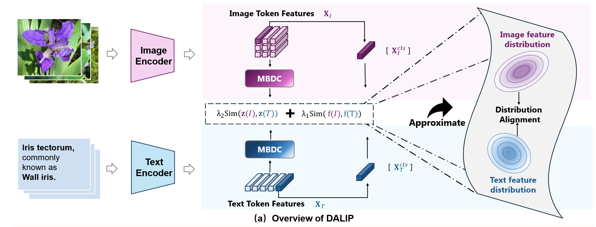

# DALIP

**Distribution Alignment-based Language-Image Pre-Training for Domain-Specific Data**

DALIP adapts CLIP-style language-image pre-training to fine-grained biological data by aligning image-text feature distributions rather than relying only on the original `[CLS]` token representation.



*Overview of DALIP for biological data. DALIP matches the similarity between feature distributions of image-text pairs, approximated by first- and second-order token-feature statistics. The Multi-head Brownian Distance Covariance (MBDC) module efficiently acquires second-order token statistics.*

## Highlights

- Distribution-alignment objective for domain-specific image-text pre-training.
- MBDC module for efficient second-order token-statistic modeling.
- PlantMix-13M dataset for plant-domain pre-training with general-domain data mixing.
- Strong performance on plant, remote-sensing, and medical-imaging downstream tasks.

## Abstract

Recently, Contrastive Language-Image Pre-training (CLIP) has shown promising performance in domain-specific data (e.g., biology), and has attracted increasing research attention. Existing works generally focus on collecting extensive domain-specific data and directly tuning the original CLIP models. Intuitively, such a paradigm takes no full consideration of the characteristics lying in domain-specific data (e.g., fine-grained nature of biological data) and so limits model capability, while mostly losing the original ability of CLIP in the general domain. In this paper, we propose a Distribution Alignment-based Language-Image Pre-Training (DALIP) method for biological data. Specifically, DALIP optimizes CLIP models by matching the similarity between feature distribution of image-text pairs instead of the original [cls] token, which can capture rich yet effective information inherent in image-text pairs as powerful representations, and so better cope with fine-grained nature of biological data. Particularly, our DALIP efficiently approximates feature distribution via its first- and second-order statistics, while presenting a Multi-head Brownian Distance Covariance (MBDC) module to acquire second-order statistics of token features efficiently. Furthermore, we collect a new dataset for plant domain (e.g., specific data in biological domain) comprising 10M plant data with 3M general-domain data (namely PlantMix-13M) according to data mixing laws. Extensive experiments show that DALIP clearly outperforms existing CLIP counterparts in biological domain, while well generalizing to remote sensing and medical imaging domains. Besides, our PlantMix-13M dataset further boosts performance of DALIP in plant domain, while preserving model ability in general domain.

## Installation

Clone the repository and install the required dependencies:

```bash
git clone https://github.com/XavierHeart/DALIP.git
cd DALIP
pip install -r requirements.txt
```

For training-specific dependencies, install:

```bash
pip install -r requirements-training.txt
```

## Dataset

PlantMix-13M is available on Hugging Face:

- Dataset repository: [HEART77/plantmix](https://huggingface.co/datasets/HEART77/plantmix)
- Hugging Face path: `HEART77/plantmix`

The dataset contains:

- 10M plant-domain image-text pairs.
- 3M general-domain image-text pairs.
- Data curated according to data-mixing laws for plant-domain pre-training.

## Model and Results

The released DALIP checkpoint is available through the model link below.

| Model | Arch. | Dataset | ImageNet-1K | Cifar-100 | Cars | Pets | Sun397 | General Mean | PlantNet | Fungi | PlantVillage | Med. Leaf | PlantDoc | Plant Mean | Mean |
| --- | --- | --- | ---: | ---: | ---: | ---: | ---: | ---: | ---: | ---: | ---: | ---: | ---: | ---: | ---: |
| OpenCLIP | ViT-B/16 | PlantMix-13M | 46.8 | 61.3 | 50.2 | 66.2 | 50.1 | 54.9 | 89.9 | 47.0 | 32.3 | 48.9 | 33.0 | 50.2 | 52.6 |
| [DALIP](https://pan.baidu.com/s/1DUOOcA5wyU-yuzpqRq4HQw?pwd=vbtk) | ViT-B/16 | PlantMix-13M | 49.2 | 69.2 | 58.9 | 75.2 | 55.6 | 61.6 | 91.0 | 52.8 | 34.5 | 43.7 | 34.3 | 51.3 | 56.4 |

## Citation

If you find this project useful, please cite the work using the metadata in [CITATION.cff](CITATION.cff).

## Acknowledgments

This project is built upon the [OpenCLIP](https://github.com/mlfoundations/open_clip) codebase. We sincerely thank them for their outstanding contribution to the open-source community.
